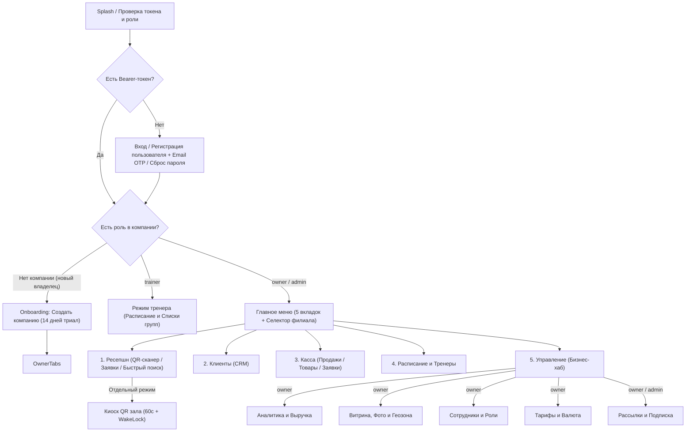

# Техническое задание: мобильное приложение uGym Business для владельцев и сотрудников зала (iOS / Android)

**Продукт:** **uGym Business** (`tj.ugym.business`)  
**Версия:** 1.0  
**Дата:** 2026-11-15  
**Статус:** Утверждено как базовое ТЗ разработки бизнес-приложения  
**Связанное приложение для посетителей:** [ТЗ uGym (iOS / Android)](uGym_Mobile_TZ.md)  
**Источники истины бэкенда:** [GymTrack_TZ_v2.md](GymTrack_TZ_v2.md), [GymTrack_Technical_TZ.md](GymTrack_Technical_TZ.md), [DECISIONS.md](../DECISIONS.md) (`D-020`, `D-021`), OpenAPI-спецификации в `docs/api/*.yaml`

---

## 0. Назначение, границы и архитектурные инварианты

### 0.1. Назначение документа
Настоящее ТЗ описывает архитектуру, ролевую модель, экраны, интеграцию с REST API (`/api/v1/business/*`, `/api/v1/auth/*`), киоск-режим ресепшна, требования безопасности и поэтапную дорожную карту разработки мобильного приложения **uGym Business** для платформ **iOS** и **Android**.

**uGym Business** предназначено для **владельцев фитнес-клубов, администраторов ресепшна и тренеров**. Клиентское приложение для посетителей вынесено в отдельный документ **uGym** ([uGym_Mobile_TZ.md](uGym_Mobile_TZ.md)). Оба приложения работают с единым бэкендом платформы (Laravel 12, модульный монолит, Этапы 0–8).

### 0.2. Границы продукта и неизменяемые инварианты
Приложение **uGym Business** **обязано** соблюдать следующие архитектурные и бизнес-инварианты бэкенда:

1. **Отсутствие онлайн-эквайринга и In-App Purchases (IAP).**
   - Приложение **не принимает банковские карты** клиентов и **не оформляет платные подписки через App Store / Google Play**.
   - Продажи на кассе и подтверждение заявок клиентов фиксируются исключительно внутренней отметкой оплаты `PaymentMark` со способом расчёта `cash` (наличные), `card_terminal` (POS-терминал в зале) или `transfer` (перевод).
   - Раздел «Подписка платформы» (`GET /api/v1/business/billing/subscription`, `GET /api/v1/business/billing/plans`) носит **строго информационный характер** (статус триала/подписки, дата окончания, тарифные лимиты) без кнопок оплаты и внешних платёжных ссылок (требование App Store Guideline 3.1.1 и Google Play Payments).
2. **Режим «только чтение» при истечении подписки (`403 SUBSCRIPTION_EXPIRED`).**
   - После создания компании автоматически стартует **14-дневный триал**.
   - Если триал истёк и подписка не продлена администратором платформы, сервер устанавливает `is_read_only = true`: все `GET`-запросы (просмотр клиентов, визитов, продаж, аналитики) продолжают работать, а **любые изменяющие запросы (`POST`/`PUT`/`PATCH`/`DELETE`) блокируются с ошибкой `403 SUBSCRIPTION_EXPIRED`**. Приложение обязано отображать глобальный баннер «Подписка истекла — доступен только просмотр» и отключать мутирующие кнопки.
3. **Добавление сотрудников только по подтверждённому Email (`D-020`).**
   - Сотрудник (`admin` или `trainer`) сначала должен зарегистрироваться (`POST /api/v1/auth/register`) и подтвердить свой email 6-значным OTP (`POST /api/v1/auth/verify-email`). Владелец приглашает/добавляет его в штат по `email` (`POST /api/v1/business/staff`).
4. **Мультиарендность (`company_id`) и работа с филиалами (`gym_id`).**
   - Один пользователь привязывается к своей компании на сервере; в компании может быть несколько залов (филиалов). Текущий выбранный филиал `gym_id` хранится локально и переключается в шапке экранов ресепшна, расписания, тренеров и витрины.
   - При смене контента или фотографий витрины зала (`PUT /gyms/{gym}/profile`, `POST/DELETE /gyms/{gym}/photos`) модерация **автоматически сбрасывается в `draft` и зал снимается с публичной витрины (`is_public = false`)** — приложение обязательно предупреждает владельца перед сохранением.
5. **Идемпотентность критических операций.**
   - Заголовок `Idempotency-Key` (строка UUID v4 до 128 символов) обязательно передаётся в:
     - `POST /api/v1/business/gyms/{id}/check-in-qr` (сканирование QR клиента);
     - `POST /api/v1/business/clients/{id}/visits` (ручная отметка посещения);
     - `POST /api/v1/business/sales` (кассовая продажа);
     - `POST /api/v1/business/membership-requests/{id}/pay` (подтверждение оплаты заявки).
6. **Деньги и время:**
   - Суммы передаются целыми числами в минимальных единицах (`price_minor`, `total_minor` — дирамы/копейки) + 3-буквенный ISO-код валюты компании (`currency`, по умолчанию `TJS`).
   - В API даты передаются в `UTC` (`DATE_ATOM`); в приложении отображаются в **часовом поясе конкретного зала** (`Gym.timezone`, по умолчанию `Asia/Dushanbe`).

### 0.3. Глоссарий
- **Back-office (`owner`, `admin`)** — управленческий и операционный персонал компании; роль `trainer` имеет отдельный ограниченный доступ.
- **PaymentMark** — отметка сотрудника об офлайн-оплате в кассе (`cash | card_terminal | transfer`), создающая чек `Sale`, списывающая остаток товаров и активирующая абонемент `Membership`.
- **Kiosk Mode (Режим стойки)** — экран с автообновляемым каждые 60 секунд HMAC QR-кодом зала, предотвращением выключения экрана и защищённым выходом для планшета/телефона на ресепшне.
- **CompanySubscription** — подписка зала на платформу (14 дней `trial` с момента регистрации компании, далее `active` или `expired`).

---

## 1. Ролевая модель и матрица прав доступа (RBAC)

Доступ к разделам определяется на бэкенде ролью пользователя в таблице сотрудников компании. На клиенте **не скрываем факт ограничения тихо** при прямом переходе — адаптируем UI под фактические права (и корректно обрабатываем `403 FORBIDDEN`).

> **Важно про получение роли при старте:** в текущей версии `/api/v1/user` возвращает объект `User`, а роль в компании определяется либо через попытку вызова `GET /api/v1/business/staff` (`200` -> `owner`), `GET /api/v1/business/gyms` (`200` -> `admin`), либо при `403` на оба — запрос расписания/профиль тренера (или проверка списка `staff` для `owner`). При наличии у пользователя только клиентского аккаунта (нет записи в `staff_members`) приложение отображает экран «Вы не являетесь сотрудником зала» с кнопками **«Создать компанию (14 дней бесплатно)»** и **«Перейти в клиентское приложение uGym»**.

### Матрица возможностей по ролям

| Модуль / Действие | `owner` (Владелец) | `admin` (Администратор) | `trainer` (Тренер) |
| :--- | :---: | :---: | :---: |
| Регистрация новой компании + 1-го зала (`POST /business/companies`) | ✓ *(если нет компании)* | — | — |
| Просмотр списка филиалов (`GET /business/gyms`) | ✓ | ✓ | — |
| Создание/редактирование филиала, геозона (`POST/PATCH /gyms`) | ✓ | — | — |
| Смена валюты компании (`PATCH /company/currency`) | ✓ | — | — |
| Управление штатом: добавление по email, смена роли, удаление (`staff`) | ✓ | — | — |
| Витрина зала, загрузка/удаление фото, модерация и публикация | ✓ | — | — |
| QR-табло зала и сканер QR клиента (`qr`, `check-in-qr`) | ✓ | ✓ | — |
| Журнал визитов, ручной чекин (в т.ч. задним числом), отмена за 24 ч | ✓ | ✓ | — |
| Поиск и создание карточек клиентов CRM (`GET/POST /clients`) | ✓ | ✓ | — |
| Объединение дублей карточек клиентов (`POST /clients/merge`) | ✓ | — | — |
| Просмотр абонементов, истекающих за 7 дней, заморозка/разморозка | ✓ | ✓ | — |
| Создание/архивация типов абонементов и принудительная отмена (`cancel`) | ✓ | — | — |
| Заявки клиентов: список, оплата `pay`, отмена `cancel` | ✓ | ✓ | — |
| Касса: список и проведение продаж `POST /sales` | ✓ | ✓ | — |
| Возврат продажи (`POST /sales/{id}/refund`) и управление товарами | ✓ | — | — |
| Тренеры: просмотр списка и карточки (`GET /trainers`) | ✓ | ✓ | — |
| Тренеры: добавление и редактирование (`POST/PATCH /trainers`) | ✓ | — | — |
| Расписание: шаблоны, генерация сетки (до 62 дн.), отмена занятия | ✓ | ✓ | — |
| Список записавшихся на занятие (`GET /schedule/sessions/{id}/bookings`) | ✓ | ✓ | ✓ |
| Финансовая (`revenue`) и сводная (`overview`) аналитика | ✓ | — | — |
| Массовые рассылки объявлений (`POST /notifications/announcements`) | ✓ | ✓ | — |
| Статус подписки компании и тарифы (`GET /billing/*`) | ✓ | ✓ | — |

---

## 2. Рекомендуемый технологический стек и архитектура клиента

### 2.1. Целевые версии ОС и устройства
- **iOS:** минимально `iOS 15.0+` (поддержка iPhone и iPad в альбомной и портретной ориентации для режима киоска QR и кассы).
- **Android:** минимально `Android 8.0 (API 26)+`, целевой API 35+; адаптация под смартфоны и ресепшн-планшеты.

### 2.2. Технологический стек
Рекомендуемый стек: **Flutter 3.x (Dart)** + единый локальный пакет `ugym_core` (Dio-клиент, интерцепторы, ErrorMapper, Money/Date форматтеры, базовая тема) для совместного развития с клиентским приложением **uGym**.

### 2.3. Архитектура кода: `Feature-First` Clean Architecture
```text
lib/
├── core/
│   ├── config/              # dev / staging / prod, BASE_URL, флаги киоск-режима
│   ├── network/             # Dio + Auth, Accept-Language, X-Request-Id, Idempotency-Key, SubscriptionInterceptor
│   ├── storage/             # SecureStorage (Sanctum token + kiosk PIN), Drift SQLite (локальный справочник)
│   ├── errors/              # Типизированный ErrorMapper (коды API + SUBSCRIPTION_EXPIRED + FORBIDDEN)
│   ├── formatting/          # MoneyFormatter (minor -> TJS), DateFormatter (UTC <-> Gym.timezone)
│   └── router/              # GoRouter с RoleGuard & SubscriptionReadOnlyBanner
└── features/
    ├── auth/                # Login (email/phone), RegisterUser, EmailOtp, ResetPassword, RoleBootstrap
    ├── company_onboarding/  # Регистрация компании + первого зала, выбор филиала, смена валюты
    ├── dashboard_analytics/ # Сводка дня/периода, графики выручки, популярные услуги, подписка
    ├── reception_qr/        # Киоск QR зала (60с + WakeLock), Сканер QR клиента, Ручной визит, Отмена (24ч)
    ├── clients_crm/         # Поиск и регистрация клиента, карточка 360°, слияние дублей
    ├── memberships_admin/   # Конструктор тарифов, истекающие за 7 дней, заморозка/разморозка/отмена
    ├── cashier_sales/       # Входящие заявки клиентов (PaymentMark), Касса, Товары, Возвраты
    ├── schedule_trainers/   # Шаблоны и генерация расписания, отмена слотов, список группы, тренеры
    ├── storefront_moderation/ # Витрина, карта/координаты, загрузка фото (до 10), отправка на модерацию
    ├── staff_management/    # Список штата, добавление по подтверждённому email, роли, удаление
    ├── announcements/       # Рассылка объявлений клиентам (Push / SMS)
    └── billing_status/      # Статус 14-дневного триала / активной подписки и лимиты тарифов
```

### 2.4. Хранение данных и безопасность персонала
- Bearer-токен хранится исключительно в **iOS Keychain** / **Android Keystore (EncryptedSharedPreferences)**.
- Пин-код выхода из **Режима киоска (QR-стойки)** хранится в SecureStorage (в виде SHA-256 хеша с солью устройства), чтобы посетители зала не могли закрыть экран QR на общем планшете ресепшна и попасть в кассу/аналитику.
- При выходе (`DELETE /client/device-tokens` при необходимости + `POST /api/v1/auth/logout`) локальный кеш компании и SecureStorage полностью очищаются.

---

## 3. Сетевой протокол, матрица ошибок и лимиты (`/api/v1`)

### 3.1. Заголовки и формат ответов
- Обязательные заголовки аналогичны клиентскому контракту: `Accept: application/json`, `Content-Type: application/json`, `Authorization: Bearer <token>`, `Accept-Language: ru|tg`, `X-Request-Id: <uuid_v4>`.
- Заголовок `Idempotency-Key` (до 128 символов) **всегда** генерируется на UI для каждого нажатия «Подтвердить оплату», «Провести продажу», «Зафиксировать чекин по QR» или «Отметить визит вручную» и сохраняется при повторе этого же действия в случае таймаута сети.
- Формат ответов: `{"data": ...}` (в т.ч. `auth/logout -> {"data": {"logged_out": true}}`, `auth/send-otp` / `verify-email` / `reset-password` -> `{"data": {"message": "..."}, "message": "..."}`); формат ошибок: `{"error": {"code": "...", "message": "...", "details": {...}}}`.

### 3.2. Матрица HTTP-статусов и реакции uGym Business

| HTTP | `error.code` | Источник | Реакция приложения uGym Business |
| :--- | :--- | :--- | :--- |
| `400` | `BAD_REQUEST` | Staff (`email` не подтверждён / уже в штате), GymProfile (`pending`), GymPhotos (лимит 10 фото), Auth OTP | Показать точное бизнес-сообщение из `error.message` (например, «Попросите сотрудника сначала подтвердить email в приложении») |
| `401` | `UNAUTHORIZED` | Auth middleware, Login | Вывести сообщение об ошибке логина либо сбросить токен и перевести на экран входа |
| `403` | `FORBIDDEN` | Политики ролей (`owner`/`admin`) | Скрыть недоступный экран или показать «Недостаточно прав (требуется роль Владелец)» |
| `403` | `SUBSCRIPTION_EXPIRED` | `EnsureActiveCompanySubscription` | Включить глобальный режим «Только чтение», отобразить баннер «Подписка истекла — операции записи заблокированы» и открыть детали в `BillingStatusScreen` |
| `404` | `GYM_NOT_FOUND`, `CLIENT_NOT_FOUND`, `PRODUCT_NOT_FOUND`, `SALE_NOT_FOUND`, `MEMBERSHIP_NOT_FOUND`, `MEMBERSHIP_TYPE_NOT_FOUND`, `NOT_FOUND` | Все модули | Обновить локальный список (возможно объект удалён или принадлежит другому филиалу/компании) |
| `409` | `CLIENT_PHONE_EXISTS` | `POST /business/clients` | Предложить открыть карточку уже существующего клиента с этим телефоном |
| `409` | `MEMBERSHIP_FREEZE_NOT_ALLOWED`, `MEMBERSHIP_ALREADY_CANCELLED` | Заморозка / отмена | Пояснить причину отказа (превышен лимит дней/раз заморозки, уже отменён) |
| `422` | `VALIDATION_FAILED` / `INVALID_MEMBERSHIP_RULES` | FormRequests / MembershipType | Подсветить невалидные поля под инпутами из `error.details` |
| `422` | `INVALID_QR_TOKEN`, `DAILY_LIMIT_EXCEEDED`, `MEMBERSHIP_FROZEN`, `OUTSIDE_ALLOWED_TIME`, `NO_ACTIVE_MEMBERSHIP` | `check-in-qr`, ручной визит | Показать крупный красный экран-результат ресепшна с причиной отказа (чтобы администратор сразу озвучил её клиенту) и кнопкой «Открыть абонементы клиента» / «Принять оплату» |
| `429` | `TOO_MANY_REQUESTS` | Rate Limiter | Уважать `Retry-After` с обратным отсчётом |

---

## 4. Карта экранов и ролевая навигация



### Адаптация вкладок под роль
- **Для `owner` (Владелец):** все 5 вкладок; на главном экране или вкладке «Управление» — быстрый виджет выручки и посещений за сегодня (`overview`), уведомление о заявках `pending` и истекающих абонементах.
- **Для `admin` (Администратор ресепшна):** вкладки «Ресепшн», «Клиенты», «Касса (заявки + продажи)», «Расписание», «Ещё» (Рассылки, Истекающие абонементы, Статус подписки, Настройки/Выход). Разделы финансов (`analytics/*`), возвратов (`refund`), витрины, тарифов и штата скрыты.
- **Для `trainer` (Тренер):** упрощённый интерфейс из 2 вкладок — «Занятия и группы» (`GET /api/v1/business/schedule/sessions/{session}/bookings` для отметки пришедших/просмотра списка) и «Профиль» (смена языка `RU/TG`, сброс пароля, выход).

---

## 5. Детальные спецификации по модулям

### 5.1. Аутентификация, регистрация компании и переключение филиала
1. **Вход, регистрация сотрудника/владельца и восстановление пароля:**
   - Вход: `POST /api/v1/auth/login` (`email` или `phone`, `password`, `device`).
   - Регистрация нового аккаунта владельца или будущего сотрудника: `POST /api/v1/auth/register` (`email` / `phone`, `password` от 8 символов) -> `POST /api/v1/auth/send-otp` -> `POST /api/v1/auth/verify-email`.
   - Сброс пароля: `POST /api/v1/auth/send-otp` -> `POST /api/v1/auth/reset-password`.
   - Выход: `POST /api/v1/auth/logout` (`{"data": {"logged_out": true}}`) + очистка Keychain/Keystore и SQLite.
2. **Создание новой компании (Onboarding владельца):**
   - **Эндпоинт:** `POST /api/v1/business/companies`
   - **Поля:** `company_name` (обяз., max 255), `gym_name` (название 1-го зала, obяз., max 255), `gym_address` (опционально, max 255).
   - **Результат (`201`):** `data: { company_id, gym_id }`, автоматически запускается 14-дневный триал. Приложение сразу подгружает список залов (`GET /api/v1/business/gyms`) и открывает главное меню владельца.
3. **Селектор филиала и валюта компании:**
   - Селектор филиала: `GET /api/v1/business/gyms` -> переключение активного `gym_id` с сохранением в локальные настройки.
   - Валюта компании (только `owner`): `GET /api/v1/business/currencies` и `PATCH /api/v1/business/company/currency` (`currency_id`).

---

### 5.2. Ресепшн: QR-табло (киоск), сканер QR клиента и визиты (`Visits`)

1. **Режим А: Киоск-экран QR зала (`GymQrKioskScreen`):**
   - **Эндпоинт:** `GET /api/v1/business/gyms/{id}/qr` -> `{ gym_id, gym_name, slot, token, ttl_seconds (60), expires_at }`.
   - **Требования UX:**
     - Крупная контрастная QR-матрица на белом фоне, название зала (`gym_name`), обратный отсчёт обновления и логотип **uGym**.
     - Автоматическое предотвращение засыпания экрана (**WakeLock**) и максимальная яркость.
     - Запрос нового токена за 3–5 секунд до `expires_at` (останавливается при выходе из экрана).
     - Опциональная кнопка «Заблокировать киоск PIN-кодом» для отдельного планшета на стойке, чтобы клиент не мог свернуть экран QR и открыть CRM/кассу.
2. **Режим Б: Сканер личного QR клиента (`ScanClientQrScreen`):**
   - **Эндпоинт:** `POST /api/v1/business/gyms/{id}/check-in-qr`
   - **Заголовки:** `Idempotency-Key: <uuid_v4>` (фиксируется на каждую отсканированную строку до результата или отмены повтора).
   - **Тело:** `{"token": "...", "device": "..."}`.
   - **UX-поток:** камера сканирует личный 60-секундный QR из приложения `uGym` -> звуковой/вибросигнал + мгновенная карточка результата (`CheckInResult`: остаток визитов `remaining_visits`, время, номер абонемента) либо крупный экран отказа (`NO_ACTIVE_MEMBERSHIP`, `MEMBERSHIP_FROZEN`, `DAILY_LIMIT_EXCEEDED`, `OUTSIDE_ALLOWED_TIME`, `INVALID_QR_TOKEN`) с быстрой кнопкой перехода к клиенту/оплате.
3. **Ручной чекин и журнал посещений:**
   - Журнал компании: `GET /api/v1/business/visits`, история конкретного клиента: `GET /api/v1/business/clients/{id}/visits`.
   - Ручная отметка посещения (`ManualCheckInSheet`): `POST /api/v1/business/clients/{id}/visits` (`Idempotency-Key`, body: `gym_id`, `visited_at?` ISO-8601 — для отметки задним числом, `device?`).
   - Отмена посещения в пределах **24 часов**: `POST /api/v1/business/visits/{id}/cancel` (обязательное поле `reason`, max 500 символов) -> автоматически возвращает списанный визит в абонемент и пишет событие в аудит.

---

### 5.3. CRM клиентов (`Clients`)

- **Поиск и список (`ClientsListScreen`):** `GET /api/v1/business/clients` (поиск по имени, телефону или email). Для каждой карточки показывать бейдж `linked` (`true` = клиент привязан к приложению `uGym`, `false` = оффлайн-карточка).
- **Быстрая регистрация клиента в зале (`CreateClientSheet`):**
  - **Эндпоинт:** `POST /api/v1/business/clients` (`name` max 255, `phone` regex `^\+?[0-9]{9,15}$`, `email?` опционально).
  - При возврате `409 CLIENT_PHONE_EXISTS` — предлагать кнопку «Открыть существующую карточку».
  - При передаче `email` в UI подсказывать сотруднику: «Если клиент подтвердит этот email в приложении uGym, карточка и абонемент привяжутся автоматически».
- **Карточка клиента 360° (`ClientDetailScreen`):**
  - Вкладки внутри карточки: **Абонементы** (`GET /clients/{id}/memberships`), **Посещения** (`GET /clients/{id}/visits` + кнопка «Отметить вручную»), **Покупки/Чеки** (`GET /clients/{id}/sales`).
  - Быстрые кнопки: «Продать абонемент/товар», «Заморозить/Разморозить».
- **Объединение дублей (только `owner`):** `POST /api/v1/business/clients/merge` (`source_id`, `target_id`) с обязательным диалогом подтверждения.

---

### 5.4. Абонементы и тарифы (`Memberships`)

1. **Конструктор типов абонементов (только `owner`):**
   - Список: `GET /api/v1/business/membership-types` (`?only_active=true|false`).
   - Активация / архивация: `PATCH /api/v1/business/membership-types/{id}/active` (`{"is_active": bool}`).
   - Создание (`CreateMembershipTypeScreen`): `POST /api/v1/business/membership-types` со строгой клиентской проверкой комбинаций правил:
     - `name` (max 255), `price_minor` (ввод в единицах валюты зала -> конвертация в минорные), `currency?`;
     - `kind`:
       - `unlimited_time` — безлимит на срок (`duration_days` обязательно, `visits_count = null`);
       - `visits_pack` — пакет визитов (`visits_count` обязательно, опционально `validity_days`);
       - `mixed` — визиты + срок (`visits_count` и `duration_days` вместе);
     - `start_mode`: `on_purchase` (активируется при продаже) или `on_first_visit` (активируется при первом входе, нельзя для чисто временного без срока и т. п. по правилам домена — при ошибке `INVALID_MEMBERSHIP_RULES` показывать точное сообщение сервера);
     - Дополнительно: `daily_limit` (1..100), временное окно `time_from` / `time_to` (формат `HH:MM`, оба вместе), лимиты заморозки `freeze_max_days`, `freeze_max_times`.
2. **Операции с выданными абонементами:**
   - **Истекающие за 7 дней:** `GET /api/v1/business/memberships/expiring` — список для прозвона/уведомления администратором.
   - **Заморозка и разморозка (`owner`/`admin`):** `POST /api/v1/business/memberships/{id}/freeze` и `POST .../unfreeze` (разморозка автоматически сдвигает `ends_at` на число дней заморозки).
   - **Отмена абонемента (только `owner`):** `POST /api/v1/business/memberships/{id}/cancel` (`reason` обязателен, max 500 символов).

---

### 5.5. Касса (`PaymentMark`), заявки клиентов и товары (`Sales`)

1. **Входящие заявки из клиентского приложения uGym (`MembershipRequestsQueueTab`):**
   - Список: `GET /api/v1/business/membership-requests` (фильтр `status: pending|paid|cancelled|expired`).
   - Обращать внимание на таймер `expires_at` (заявка действует 24 часа).
   - **Подтверждение оплаты на кассе (`POST /api/v1/business/membership-requests/{id}/pay`):**
     - Выбор способа оплаты `payment_method`: **Наличные (`cash`)**, **Терминал (`card_terminal`)**, **Перевод (`transfer`)**.
     - Обязательно передаётся `Idempotency-Key`.
     - Сервер возвращает `request_id, sale_id, membership_id, client_id, status, paid_at`; клиент получает push-уведомление в `uGym`.
   - **Отмена заявки:** `POST /api/v1/business/membership-requests/{id}/cancel` (`reason?` до 255 символов).
2. **Касса / Проведение новой продажи (`PosCheckoutScreen`):**
   - **Эндпоинт:** `POST /api/v1/business/sales` (с заголовком `Idempotency-Key`).
   - Выбор клиента (`client_id` — обязателен при продаже абонемента; может быть `null` при быстрой продаже воды/бара анонимному посетителю).
   - Добавление в корзину товаров (`products[]: {product_id, quantity}`) и/или абонементов (`membership_type_ids[]`).
   - Предпросмотр итоговой суммы в валюте зала и выбор `payment_method` (`cash | card_terminal | transfer`).
3. **История продаж и возвраты:**
   - Список всех продаж компании: `GET /api/v1/business/sales`.
   - **Возврат продажи (только `owner`):** `POST /api/v1/business/sales/{id}/refund` (`reason` обязателен, max 500 символов) -> восстанавливает остаток товаров и отменяет выданные по чеку абонементы.
4. **Склад товаров:**
   - Просмотр (`owner`/`admin`): `GET /api/v1/business/products` (`?only_active=true|false`) с показом остатка `stock_quantity`.
   - Создание и корректировка остатков/активности (только `owner`): `POST /api/v1/business/products` (`name`, `price_minor`, `currency?`, `stock_quantity?`) и `PATCH /api/v1/business/products/{id}` (`is_active?`, `stock_quantity?`).

---

### 5.6. Тренеры и расписание групповых занятий (`Trainers` & `Schedule`)

1. **Тренеры зала:**
   - Просмотр списка и карточки (`owner`/`admin`): `GET /api/v1/business/trainers?gym_id=...` и `GET /api/v1/business/trainers/{trainer}`.
   - Добавление и редактирование (только `owner`): `POST /api/v1/business/trainers` (`gym_id`, `name`, `bio?`) и `PATCH /api/v1/business/trainers/{trainer}` (`name`, `bio?`, `is_active?`).
2. **Еженедельные шаблоны расписания (`owner`/`admin`):**
   - `GET /api/v1/business/schedule/templates?gym_id=...&only_active=...`
   - `POST` и `PATCH /api/v1/business/schedule/templates/{template?}`: выбор зала, активного тренера, названия (`title` max 100), описания (`max 1000`), дня недели (`weekday`: 1 Пн .. 7 Вс), времени начала (`start_time_minute`: `0..1439` через TimePicker `HH:MM`), длительности (`duration_minutes`: `15..240` мин), вместимости (`capacity`: `1..200` мест) и статуса `is_active`.
3. **Сетка занятий, генерация и отмена (`owner`/`admin`):**
   - Календарь слотов: `GET /api/v1/business/schedule/sessions?gym_id=...&from_date=YYYY-MM-DD&to_date=YYYY-MM-DD`.
   - Мастер генерации: `POST /api/v1/business/schedule/sessions/generate` (`gym_id`, `from_date`, `to_date` — период не более **62 дней**; операция идемпотентна по `(template_id, starts_at)`).
   - Отмена занятия: `POST /api/v1/business/schedule/sessions/{session}/cancel` с диалогом подтверждения: «Занятие будет отменено, а всем записавшимся клиентам автоматически вернутся списанные посещения».
4. **Список записавшихся клиентов (`owner`, `admin` и `trainer`):**
   - `GET /api/v1/business/schedule/sessions/{session}/bookings` — просмотр имён/идентификаторов записавшихся, счётчиков `booked_count / capacity` и статусов `booked | cancelled`.

---

### 5.7. Филиалы, витрина, фотографии и сотрудники (только `owner`)

1. **Управление филиалами (`GymsManagementScreen`):**
   - `POST /api/v1/business/gyms` и `PATCH /api/v1/business/gyms/{gym}`: `name`, `address?`, `timezone` (по умолчанию `Asia/Dushanbe`, выбор из валидных IANA TZ), `geo_check_enabled` (включить проверку GPS на входе при сканировании QR), `geo_check_radius_meters` (`50..5000` м, слайдер, по умолчанию `200`).
2. **Редактор витрины в публичном каталоге `uGym` (`StorefrontEditorScreen`):**
   - `PUT /api/v1/business/gyms/{gym}/profile`:
     - `description` (max 5000), `address` (max 255), `district` (район, max 100), координаты `latitude` (`-90..90`) и `longitude` (`-180..180`) с пикером точки на карте, `phone` (max 32), `working_hours` (структурированный редактор по дням недели), `amenities` (теги удобств, до 30 шт. по 50 символов).
     - **Предупреждение UX:** сохранение `PUT` очищает неопределённые поля и **переводит витрину из `approved` обратно в `draft` со снятием с публикации**; в статусе `pending` редактирование заблокировано (`400 BAD_REQUEST`).
   - Отправка на модерацию: `POST /api/v1/business/gyms/{gym}/profile/submit` (показывать текущий бейдж `moderation_status`: `draft | pending | approved | rejected` и `rejection_reason` при отказе).
   - Публикация в каталоге: `PATCH /api/v1/business/gyms/{gym}/publication` (`{"is_public": true|false}`) — включение доступно только при `moderation_status == approved`.
3. **Фотогалерея зала (`GymPhotosManager`):**
   - Лимит **до 10 фото**, форматы `jpeg / png / webp`, до **5 МБ** на файл (сжимать на устройстве до загрузки).
   - Загрузка: `POST /api/v1/business/gyms/{gym}/photos` (`multipart/form-data`, поле `photo`). Удаление: `DELETE /api/v1/business/gyms/{gym}/photos/{photo}`. Оба действия недоступны при `pending` и переводят витрину в `draft`.
4. **Штат сотрудников (`StaffManagementScreen`):**
   - Список: `GET /api/v1/business/staff` (`id, user_id, role, name, phone, email`).
   - Приглашение/добавление: `POST /api/v1/business/staff` (`email`, `role: admin|trainer`). Если сервер вернул `400 BAD_REQUEST` (не найден или email не подтверждён), показать пошаговую памятку: «Сотрудник должен установить uGym/uGym Business, зарегистрироваться с этим email и ввести OTP-код подтверждения».
   - Смена роли (`admin <-> trainer`): `PATCH /api/v1/business/staff/{staff}`. Удаление (кроме единственного `owner`): `DELETE /api/v1/business/staff/{staff}`.

---

### 5.8. Аналитика владельца, рассылки и подписка платформы

1. **Аналитика и выручка (только `owner`):**
   - Фильтр периода `[from, to]` (сегодня, неделя, месяц, произвольный диапазон) + `inactive_days` (`1..365`, по умолчанию `14`).
   - **Сводка (`GET /api/v1/business/analytics/overview`):**
     - Выручка (`revenue`: `total_minor`, `memberships_minor`, `products_minor`, `sales_count`, разбивка по `cash / card_terminal / transfer`);
     - Клиенты (`total_clients`, `new_clients`, `existing_clients`);
     - Посещаемость (`total_visits`, `qr_visits`, `manual_visits`, график по дням `by_day`, число неактивных клиентов `inactive_clients_count` за N дней);
     - Топ-тарифы `popular_memberships[]` и топ-товары `popular_products[]`.
   - **Отчёт о выручке (`GET /api/v1/business/analytics/revenue`):** детализация сумм по дням/периоду и методам оплаты.
2. **Массовые рассылки объявлений (`AnnouncementsScreen`, `owner`/`admin`):**
   - **Эндпоинт:** `POST /api/v1/business/notifications/announcements`
   - Поля: `channel` (`push` — пользователям с аккаунтом, `sms` — клиентам с телефоном), `title` (max 120), `body` (max 1000).
   - Ответ `202 Accepted` — уведомления поставлены в фоновую очередь воркера.
3. **Подписка компании на платформу (`BillingStatusScreen`, `owner`/`admin`):**
   - **Эндпоинты:** `GET /api/v1/business/billing/subscription` (`status: trial|active|expired`, `is_read_only`, `starts_at`, `ends_at`, `plan_id`) и `GET /api/v1/business/billing/plans` (`name, period: month|year, price_minor, max_gyms, max_staff`).
   - Отображает текущий тариф, дату окончания триала/подписки и лимиты на филиалы/сотрудников (без кнопок онлайн-оплаты).

---

## 6. Нефункциональные требования, режим киоска, локализация и публикация

### 6.1. Производительность и надёжность ресепшна
- Распознавание QR-кода клиента на входе (`check-in-qr`) и отклик камеры: `<= 1.5 сек` на стабильном 4G/LTE.
- Обязательная защита от двойного считывания: после распознавания QR сканер уходит в паузу до получения ответа API или явного нажатия «Сканировать следующего».
- Для операций с `Idempotency-Key` (`check-in-qr`, `pay`, `sales`, `manual visit`) при временном сетевом обрыве приложение хранит ключ до завершения текущей попытки, чтобы повторный тап не вызвал дубль списания или дубль чека.

### 6.2. Локализация и форматирование
- Поддерживаются **Русский (`ru`, по умолчанию)** и **Таджикский (`tg`)** языки (мгновенное переключение в Профиле + заголовок `Accept-Language`).
- **Валюта:** формат `minor / 100` с кодом валюты компании (например, `350 TJS` или `12.50 TJS`), единый для кассы, каталога и аналитики.
- **Время:** все временные метки отображаются в часовом поясе выбранного филиала (`Gym.timezone`, например `Asia/Dushanbe`). Минуты шаблона (`start_time_minute`) отображаются как `HH:MM`.

### 6.3. Требования App Store Review (Apple) и Google Play
1. **Запрет IAP и внешних платёжных ссылок (`App Store Guideline 3.1.1` / `Google Play`):**
   - В экране «Подписка платформы» (`billing/subscription`) не должно быть кнопок покупки, форм ввода карт и прямых URL на внешнюю оплату; отображается только текущий статус тарифа и лимиты (активация проводится B2B-менеджером платформы вне приложения).
   - На кассе и в заявках явно указано, что это учёт наличных/терминала в зале (`PaymentMark`).
2. **Разрешения в манифестах:**
   - `NSCameraUsageDescription` — для сканирования QR-кодов посетителей на ресепшне и фотографий витрины зала.
   - Фотогалерея (`NSPhotoLibraryUsageDescription` / Photo Picker Android) — для загрузки фотографий зала в витрину (`PUT/POST photos`).
   - Фоновая геолокация и Bluetooth не требуются. Для определения координат филиала на карте в редакторе витрины (`owner`) достаточно пикера точки на карте или однократного `WhenInUse`.
3. **Демо-доступ для ревьюеров:**
   - Выделить для модераторов Apple/Google тестовый аккаунт `owner` в демо-зале с активной подпиской (`trial`/`active`), тестовым клиентом, 1–2 заявками `pending` и заполненной аналитикой.
   - Указать в заметках для ревьюеров, что приложение предназначено для сотрудников и владельцев фитнес-клубов (B2B companion app к **uGym**), а учётные данные демонстрационного зала приложены.

---

## 7. Поэтапная дорожная карта (`B0`–`B4`) и приёмочный чек-лист

### 7.1. План этапов разработки

| Этап | Название | Состав работ | Критерий готовности этапа |
| :--- | :--- | :--- | :--- |
| **B0** | Фундамент проекта | Инициализация `uGym Business` (`tj.ugym.business`); переиспользование/создание общего сетевого ядра (`Dio`, `Auth`, `Accept-Language`, `X-Request-Id`, `Idempotency-Key`); `RoleGuard` + перехватчик `SUBSCRIPTION_EXPIRED`; SecureStorage (токен + PIN киоска); селектор филиала; словари `RU`/`TG` | Приложение собирается под iOS/Android, проходит `/health`, переключает язык `ru/tg` |
| **B1** | Авторизация, Онбординг, Киоск QR и Визиты | Login (email/phone), Register + Email OTP, Reset Password, Logout; Onboarding новой компании (`POST /business/companies`); Киоск-режим QR зала (`60с`, WakeLock, PIN выхода); Сканер личного QR клиента (`check-in-qr`); журнал визитов, ручной чекин (в т.ч. задним числом) и отмена за 24 ч | Сотрудник может создать компанию или войти, вывести QR-табло на планшет, просканировать QR клиента и отменить ошибочный визит |
| **B2** | CRM клиентов, Абонементы и Касса (`PaymentMark`) | Поиск/создание клиента, карточка 360°, слияние дублей (`owner`); список истекающих за 7 дней; заморозка/разморозка/отмена абонемента; конструктор тарифов (`owner`); очередь заявок (`pay` / `cancel`); касса (`POST /sales`), возвраты (`refund`), склад товаров | Администратор принимает оплату заявки наличными/терминалом, продаёт товар, а у клиента сразу появляется чек и активный абонемент в `uGym` |
| **B3** | Расписание, Тренеры, Витрина, Штат и Аналитика | Тренеры и шаблоны расписания; генерация до 62 дней; отмена занятия с возвратом визитов; экран тренера (список группы `bookings`); редактор витрины + загрузка до 10 фото + модерация + публикация; штат по email; аналитика выручки и обзор (`overview`); рассылки `push`/`sms`; статус подписки | Владелец заполняет витрину и фото, добавляет тренера/админа по email, генерирует расписание и видит графики выручки/посещений |
| **B4** | Полировка UX, Режим чтения, QA и Релиз | Тестирование ролевого доступа (`owner`/`admin`/`trainer`) и режима `SUBSCRIPTION_EXPIRED`; тесты устойчивости киоска и кассы к потере сети (`Idempotency-Key`); iPad/tablet-адаптация киоска; Privacy Manifest & Data Safety; релиз в TestFlight / Google Play | Чек-лист приёмки (п. 7.2) пройден на 100% на реальных iOS и Android устройствах |

### 7.2. Приёмочный чек-лист (Acceptance Criteria: Дано — Когда — Тогда)

1. **Онбординг компании и 14-дневный триал:**
   - *Дано:* новый владелец зала зарегистрировался, подтвердил email по OTP и не состоит ни в одной компании.
   - *Когда:* заполняет форму `POST /business/companies` (`company_name`, `gym_name`).
   - *Тогда:* создаётся компания и первый зал, автоматически активируется 14-дневный триал (`GET /billing/subscription` показывает `trial`, `is_read_only = false`), и владелец попадает в рабочий дашборд.
2. **Приём оплаты заявки клиента на кассе (`PaymentMark`):**
   - *Дано:* клиент оформил заявку в `uGym` (`status: pending`) и подошёл на кассу с наличными.
   - *Когда:* администратор в **uGym Business** открывает вкладку заявок, выбирает `cash` и подтверждает `POST /membership-requests/{id}/pay` (с `Idempotency-Key`).
   - *Тогда:* заявка переходит в `paid`, формируется продажа `Sale`, клиенту выдаётся абонемент, а при повторном нажатии во время слабого интернета дубль чека и второго абонемента не создаётся.
3. **Двусторонний QR-ресепшн и отказ по правилам тарифа:**
   - *Дано:* клиент показывает на экране `uGym` свой личный динамический QR-код.
   - *Когда:* администратор сканирует его в **uGym Business**.
   - *Тогда:* при валидном абонементе фиксируется визит `201 CheckInResult` и уменьшается `remaining_visits`; при просрочке/заморозке/выходе из временного окна экран ресепшна крупно показывает причину отказа (`422`) и предлагает открыть карточку клиента.
4. **Правка витрины и модерация:**
   - *Дано:* у филиала витрина была в статусе `approved` и `is_public = true`.
   - *Когда:* владелец добавляет новое фото или меняет описание через `uGym Business`.
   - *Тогда:* до отправки формы приложение предупреждает, что публикация будет временно отключена до повторной модерации; после сохранения статус становится `draft`, и владелец в один тап отправляет карточку на проверку (`POST /profile/submit`).
5. **Блокировка при истекшей подписке (`SUBSCRIPTION_EXPIRED`):**
   - *Дано:* у компании истёк триал или платная подписка (`is_read_only = true`).
   - *Когда:* владелец или администратор открывает **uGym Business** и пытается пробить продажу или отметить визит.
   - *Тогда:* просмотр всех журналов, клиентов и аналитики работает без ошибок, наверху показан баннер «Подписка истекла — режим просмотра», а мутирующие действия отключены (или корректно перехватывают `403 SUBSCRIPTION_EXPIRED`).
6. **Добавление тренера по email и просмотр его группы:**
   - *Дано:* тренер зарегистрировал аккаунт и подтвердил свой email через OTP.
   - *Когда:* владелец добавляет его в штат с ролью `trainer` по этому email (`POST /business/staff`), и тренер входит в **uGym Business**.
   - *Тогда:* тренер видит доступный ему экран расписания и список записавшихся клиентов на занятие (`GET /schedule/sessions/{session}/bookings`), но не имеет доступа к кассе, CRM и аналитике.

