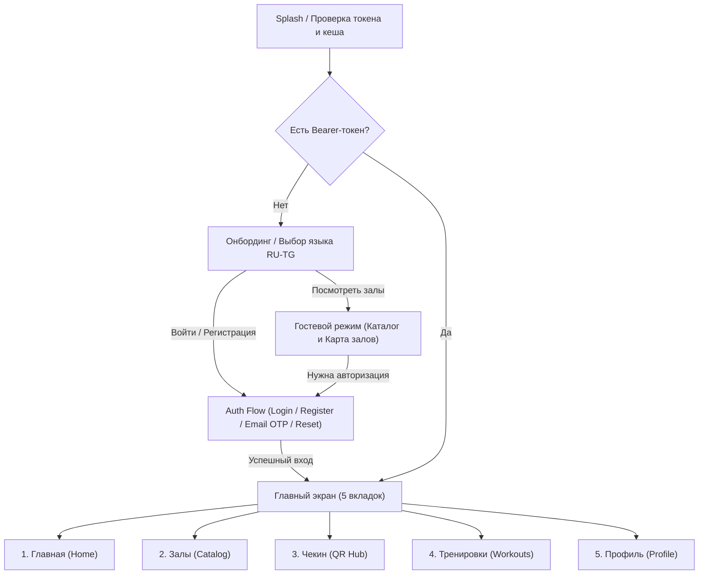

# Техническое задание: мобильное приложение uGym для посетителей (iOS / Android)

**Продукт:** **uGym** (`tj.ugym.client`)  
**Версия:** 1.1  
**Дата:** 2026-11-15  
**Статус:** Утверждено как базовое ТЗ разработки клиентского мобильного приложения  
**Связанное приложение для залов:** [ТЗ uGym Business (iOS / Android)](uGym_Business_Mobile_TZ.md)  
**Источники истины бэкенда:** [GymTrack_TZ_v2.md](GymTrack_TZ_v2.md), [GymTrack_Technical_TZ.md](GymTrack_Technical_TZ.md), [DECISIONS.md](../DECISIONS.md) (`D-020`, `D-021`), OpenAPI-спецификации в `docs/api/*.yaml`

---

## 0. Назначение, границы и архитектурные инварианты

### 0.1. Назначение документа
Настоящее ТЗ описывает архитектуру, UX/навигацию, интеграцию с готовым REST API (`/api/v1`), офлайн-логику, требования безопасности и дорожную карту разработки клиентского мобильного приложения **uGym** для платформ **iOS** и **Android**.

**uGym** предназначено исключительно для **посетителей фитнес-залов** (`client` + гостевой просмотр каталога). Функционал владельца, администратора и тренера зала вынесен в отдельное мобильное приложение **uGym Business** ([uGym_Business_Mobile_TZ.md](uGym_Business_Mobile_TZ.md)).

Бэкенд платформы (модульный монолит на Laravel 12, Этапы 0–8) полностью реализован и обслуживает оба приложения через единое API.

### 0.2. Границы продукта и неизменяемые инварианты
Приложение **uGym** **обязано** соблюдать следующие архитектурные и бизнес-инварианты бэкенда:

1. **Никаких онлайн-платежей и In-App Purchases (IAP).** Приложение не принимает банковские карты, Apple Pay, Google Pay, локальные кошельки и не оформляет автоподписки. Клиент может создать только **заявку на покупку абонемента** (`MembershipRequest`, срок действия 24 часа), после чего оплачивает её **офлайн на кассе зала**, а сотрудник зала подтверждает оплату через `uGym Business` (`PaymentMark`).
2. **Подтверждение аккаунта через Email OTP (`D-020`).** SMS-провайдер не используется. Верификация пользователя и автоматическое связывание с CRM-профилями залов и приглашениями происходят по **подтверждённому email** через одноразовый 6-значный код (OTP). При этом вход в аккаунт поддерживается как по `email`, так и по `phone` (если номер указан).
3. **Возрастной ценз 18+ и согласие на обработку ПДн.** Регистрация нового клиента разрешена только пользователям старше 18 лет (`birth_date`) и при явном согласии на обработку персональных данных (`consent: true`).
4. **Двусторонний динамический QR-код с HMAC и интервалом 60 секунд.** Поддерживаются оба сценария входа:
   - *Режим А (основной):* клиент сканирует QR-код, отображаемый на стойке/экране зала (`uGym Business`).
   - *Режим Б (резервный / для турникетов-сканеров):* клиент показывает на экране смартфона свой динамический QR-код (`GET /api/v1/client/visits/qr`), а сотрудник сканирует его.
   - Клиентское приложение **не генерирует и не проверяет HMAC-подпись** локально — токен `token` передаётся и отображается как непрозрачная строка.
5. **Идемпотентность критических операций.** Запросы отметки посещения, создания заявки на абонемент, записи на групповое занятие, старта тренировочной сессии и логирования подходов в тренировках обязаны отправляться с заголовком `Idempotency-Key` (строка до 128 символов, UUID v4), чтобы повторная отправка при обрыве связи или фоновой синхронизации не приводила к двойному списанию визита, дублю записи или дублированию подходов.
6. **Единицы измерения и время:**
   - Деньги: целые числа в минимальных единицах (`price_minor`, `total_minor` — дирамы/копейки) + 3-буквенный ISO-код валюты (`currency`, по умолчанию `TJS`).
   - Вес в дневнике тренировок: целые числа в граммах (`weight_grams`, `volume_grams`, `target_weight_grams`). В интерфейсе пользователь вводит и видит килограммы (`кг`), приложение конвертирует `кг * 1000 -> weight_grams`.
   - Даты и время: сервер хранит и отдаёт `UTC` в формате ISO-8601 (`DATE_ATOM`). Мобильное приложение отображает время в локальном часовом поясе устройства (или в часовом поясе целевого региона — по умолчанию `Asia/Dushanbe`).

### 0.3. Глоссарий
- **Sanctum Bearer Token** — токен авторизации Laravel Sanctum, передаваемый в заголовке `Authorization: Bearer <token>`.
- **OTP (One-Time Password)** — одноразовый 6-значный цифровой код подтверждения, отправляемый на email.
- **HMAC QR** — криптографически подписанный токен QR-кода, автоматически сменяемый каждые 60 секунд (`ttl_seconds: 60`).
- **Idempotency-Key** — уникальный ключ операции в HTTP-заголовке, гарантирующий однократное выполнение действия при сетевых повторах.
- **ULID** — 26-символьный публичный строковый идентификатор объекта (например, `01JCXYZ0000000000000000000`), применяемый в публичном каталоге.
- **GeoFence (Геозона)** — опциональная проверка координат (`latitude`, `longitude`) на расстоянии заданного радиуса от зала при чекине.
- **PaymentMark** — внутренняя отметка сотрудника об офлайн-оплате в зале, после которой на стороне клиента появляется чек `Sale` и активный абонемент `Membership`.

---

## 1. Целевая аудитория и состояния пользователя

### 1.1. Основная роль: Посетитель залов (`uGym Client`)
Приложение **uGym** ориентировано на **одного клиента**, который может одновременно иметь абонементы в нескольких разных фитнес-залах и сетях (`company_id`).

Состояния пользователя:
1. **Гость (без авторизации):**
   - Просмотр публичного каталога залов (поиск, фильтры, карта, карточка зала, тарифы, расписание, отзывы).
   - Переключение языка интерфейса (`RU` / `TJ`).
   - При попытке чекина, оформления заявки, записи на занятие, ведения тренировок или отправки отзыва — редирект на экран входа/регистрации с возвратом к исходному действию.
2. **Авторизованный клиент с неподтверждённым email (`is_email_verified = false`):**
   - После регистрации (`POST /api/v1/client/auth/register`) клиент может авторизоваться через `/api/v1/auth/login`, однако **привязка существующих CRM-профилей залов и приглашений срабатывает только после подтверждения email** (`D-020`).
   - UX-правило: сразу после регистрации приложение логинит пользователя, запускает отправку OTP и открывает экран подтверждения email. Если пользователь нажимает «Подтвердить позже», приложение пускает его внутрь, но отображает заметный баннер-напоминание на Главной и в Профиле.
3. **Авторизованный клиент с подтверждённым email (`is_email_verified = true`):**
   - Полный доступ ко всем клиентским функциям: QR-чекин, абонементы, заявки и чеки, запись на групповые занятия, дневник тренировок и графики прогресса, публикация отзывов (после посещения зала), push-уведомления, удаление аккаунта.

> **Примечание для владельцев и персонала зала:** управление филиалами, касса, CRM, расписание со стороны зала и сканер клиентских QR реализуются в отдельном приложении **uGym Business** ([uGym_Business_Mobile_TZ.md](uGym_Business_Mobile_TZ.md)). Если пользователь входит в `uGym`, имея роль сотрудника в каком-то зале, он всё равно работает только со своими личными абонементами и тренировками как клиент.

---

## 2. Рекомендуемый технологический стек и архитектура клиента

### 2.1. Целевые версии ОС
- **iOS:** минимально `iOS 15.0+` (сборка актуальным Xcode с обязательным `PrivacyInfo.xcprivacy`).
- **Android:** минимально `Android 8.0 (API 26)+`, `targetSdk` в соответствии с актуальными требованиями Google Play (API 35+).

### 2.2. Выбор фреймворка
| Критерий | **Flutter 3.x (Dart)** *(Рекомендуется)* | **React Native (TS / Expo SDK 52+)** | **Native (Swift + Kotlin)** |
| :--- | :--- | :--- | :--- |
| Стоимость разработки (1–2 разработчика) | 1 кодовая база (~100% общего кода) | 1 кодовая база (~90% общего кода) | 2 кодовые базы (x2 трудозатраты) |
| Камера/QR, графики 60/120 fps, таймеры | Стабильный Impeller-рендер, зрелый `mobile_scanner` | Зависимость от нативного моста / версий Expo | Эталонная нативность |
| Локальная БД и офлайн-синхронизация | Строго типизированный `drift` (SQLite) | WatermelonDB / SQLite / MMKV | SwiftData / Room |
| Переиспользование ядра с `uGym Business` | Общий локальный пакет `ugym_core` (API-клиент, форматирование, дизайн-токены) | Общий monorepo-пакет `packages/core` | Отдельные модули |

**Решение:** рекомендуется **Flutter 3.x (Dart)** с выделением общего сетевого/UI-ядра при параллельной разработке **uGym** и **uGym Business**. Итоговый выбор стека фиксируется разработчиком перед стартом этапа `M0` в [DECISIONS.md](../DECISIONS.md).

### 2.3. Архитектура кода: `Feature-First` Clean Architecture
Структура модулей клиентского приложения зеркалирует клиентские модули бэкенда:

```text
lib/
├── core/
│   ├── config/          # Flavor-конфиги (dev / staging / prod), BASE_URL
│   ├── network/         # HTTP-клиент (Dio), интерцепторы: Auth, Locale, RequestId, Idempotency
│   ├── storage/         # SecureStorage (Sanctum token), Drift SQLite (кеш + очередь синхронизации)
│   ├── errors/          # Типизированный ErrorMapper (code -> локализованный UI-текст)
│   ├── formatting/      # MoneyFormatter (minor -> TJS), WeightFormatter (grams <-> kg), DateFormatter (UTC -> local)
│   ├── permissions/     # Камера, геолокация WhenInUse, Push
│   └── router/          # Навигация, AuthGuard, DeepLinks
└── features/
    ├── auth/            # Login, ClientRegister (18+/PDPA), EmailOtpVerify, ResetPassword
    ├── catalog/         # Поиск залов, карта, карточка, тарифы, отзывы
    ├── visits_qr/       # Сканер QR зала, 2-шаговый GeoFence, личный 60с QR, история визитов
    ├── memberships/     # Мои абонементы, заявки на покупку, история чеков
    ├── schedule/        # Расписание зала, запись, отмена, локальные напоминания
    ├── workouts/        # Упражнения, библиотека планов, конструктор, живая сессия, 1RM-прогресс
    ├── notifications/   # FCM/APNs регистрация токенов, маршрутизация пушей
    └── profile/         # Профиль, язык RU/TG, выход, удаление аккаунта
```

Внутри каждой фичи строго соблюдается разделение на 3 слоя:
- `domain` — чистые модели (Entities/Value Objects) и интерфейсы репозиториев без привязки к UI и HTTP;
- `data` — REST DataSources (DTO сериализации), Local DAO (SQLite), реализации репозиториев;
- `presentation` — State Management (Riverpod или BLoC), экраны и виджеты.

### 2.4. Хранение данных, безопасность и аппаратные разрешения
- **Хранение токена:** только **iOS Keychain** / **Android Keystore (EncryptedSharedPreferences)** через Secure Storage. Сохранение Bearer-токена в открытом виде (`SharedPreferences`, `UserDefaults`, SQLite) запрещено.
- **Локальная БД (SQLite):** хранит кеш абонементов, списка залов (недавно открытых), расписания, справочника упражнений, планов тренировок и таблицу `pending_sync_operations` для офлайн-очереди подходов в зале. При удалении аккаунта или выходе другого пользователя локальная БД полностью очищается.
- **Сетевая безопасность:** только `HTTPS` (TLS 1.2+) для `staging`/`prod`; `cleartextTraffic` и `NSAllowsArbitraryLoads` разрешены исключительно в локальной `dev`-сборке.
- **Разрешения (Permissions):**
  - *Камера:* запрашивается **только в момент** нажатия на сканер QR. При отказе открывается понятный экран с кнопкой «Показать мой QR вместо сканера» и переходом в Настройки ОС.
  - *Геолокация:* запрашивается **только `WhenInUse`** (никогда не запрашивать `Always` / фоновую геолокацию). Вызывается при нажатии «Рядом со мной» в каталоге или при получении ошибки `GEO_LOCATION_REQUIRED` во время чекина.
  - *Push-уведомления:* мягкий пре-диалог с объяснением пользы (напоминания о занятиях, окончании абонемента и подтверждении заявки) перед системным запросом ОС.

---

## 3. Сетевой протокол и контракт с бэкендом (`/api/v1`)

### 3.1. Заголовки запросов и ответов
| Заголовок | Направление | Обязательность | Правило для мобильного клиента |
| :--- | :--- | :--- | :--- |
| `Accept` | Request | Всегда | `application/json` |
| `Content-Type` | Request | Для body | `application/json` |
| `Authorization` | Request | Защищённые API | `Bearer <sanctum_token>` |
| `Accept-Language` | Request | Всегда | `ru` или `tg` (соответствует выбранному языку в приложении; сервер возвращает `Content-Language`) |
| `X-Request-Id` | Req / Resp | Всегда | Генерируется клиентом (UUID v4, допустимый формат `[A-Za-z0-9._-]{1,64}`). Сервер возвращает его же в ответе — логировать в отчётах об ошибках |
| `Idempotency-Key` | Request | Критичные POST | UUID v4 (макс. 128 символов). Обязательно передавать для: `/client/visits/check-in`, `/client/membership-requests`, `/client/schedule/sessions/{session}/book`, `/client/workouts/sessions`, `/client/workouts/sessions/{session}/sets` |

### 3.2. Формат ответов JSON
1. **Стандартный успешный ответ:**
   ```json
   { "data": { ... } }
   ```
   Списки с пагинацией (`public/gyms`, `public/gyms/{id}/reviews`, `client/visits`, `client/purchases`, `client/schedule/bookings`):
   ```json
   {
     "data": [ ... ],
     "meta": { "page": 1, "per_page": 20, "total": 42 }
   }
   ```
   Публичное расписание (`public/gyms/{publicId}/schedule`) возвращает:
   ```json
   {
     "data": [ ... ],
     "meta": { "from_date": "2026-11-15", "to_date": "2026-11-21" }
   }
   ```
2. **Формат ответов auth и совместимость парсера (`D-021`):**
   - `POST /api/v1/auth/send-otp`, `POST /api/v1/auth/verify-email` и `POST /api/v1/auth/reset-password` возвращают унифицированную обёртку `{"data": {"message": "..."}, "message": "..."}` (верхнеуровневый ключ `message` сохранён для обратной совместимости), а `POST /api/v1/auth/logout` возвращает `{"data": {"logged_out": true}}`.
   - `GET /api/v1/user` возвращает объект модели `User` напрямую в корне JSON (без обёртки `data`), поэтому приложение **uGym** использует `GET /api/v1/client/profile`, который всегда возвращает `{"data": {...}}`.
3. **Стандартный формат ошибки:**
   ```json
   {
     "error": {
       "code": "VALIDATION_FAILED",
       "message": "Человекочитаемое сообщение на языке ru или tg",
       "details": {
         "field_name": ["Описание ошибки поля"]
       }
     }
   }
   ```
   Поле `details` присутствует при ошибке валидации `VALIDATION_FAILED` (`422`).

### 3.3. Матрица HTTP-статусов, кодов ошибок и поведения клиента

| HTTP | `error.code` | Источник | Реакция мобильного приложения uGym |
| :--- | :--- | :--- | :--- |
| `400` | `BAD_REQUEST` | Auth (`VerifyEmail`, `ResetPassword`), Workouts | Показать `error.message` (например, неверный/истёкший OTP-код, превышение длины `Idempotency-Key` > 128 символов или недопустимое состояние тренировочной сессии) |
| `401` | `UNAUTHORIZED` | Auth middleware, `LoginUser`, Reviews | На экране входа — показать ошибку неверных учётных данных. На любом защищённом API — сбросить токен из SecureStorage и перенаправить на экран входа (с сохранением локальных несинхронизированных черновиков тренировок) |
| `403` | `FORBIDDEN` | Права доступа | Сообщить об отсутствии прав на ресурс |
| `403` | `VISIT_REQUIRED_FOR_REVIEW` | Catalog Reviews | Пояснить клиенту: оставить отзыв можно только после минимум одного завершённого посещения этого зала |
| `404` | `NOT_FOUND`, `GYM_NOT_FOUND` | Catalog, Schedule, Workouts, Visits | Показать empty state «Объект не найден или удалён» и обновить локальный кеш |
| `409` | `EMAIL_ALREADY_REGISTERED`, `PHONE_ALREADY_REGISTERED` | Client Registration | Подсветить поле email/телефона и предложить кнопку «Войти в существующий аккаунт» |
| `422` | `VALIDATION_FAILED` | FormRequest | Подсветить ошибки полей из `error.details` под соответствующими инпутами |
| `422` | `UNDERAGE_REGISTRATION_NOT_ALLOWED`, `PERSONAL_DATA_CONSENT_REQUIRED` | Client Registration | Подсветить дату рождения (< 18 лет) или чекбокс согласия ПДн |
| `422` | `INVALID_QR_TOKEN`, `DAILY_LIMIT_EXCEEDED`, `MEMBERSHIP_FROZEN`, `OUTSIDE_ALLOWED_TIME`, `NO_ACTIVE_MEMBERSHIP` | Visits (`check-in`), Schedule (`book`) | Показать специализированный статус-экран отказа с точным объяснением причины и CTA («Показать абонементы», «Попросить администратора») |
| `422` | `GEO_LOCATION_REQUIRED` | Visits (`check-in`) | Запустить 2-шаговый запрос `WhenInUse` геолокации и повторно отправить чекин с координатами (см. п. 5.2) |
| `422` | `OUTSIDE_GYM_GEOFENCE` | Visits (`check-in`) | Пояснить, что клиент слишком далеко от зала; предложить включить точный GPS, подойти ко входу и повторить или использовать личный QR у стойки |
| `422` | `CLASS_SESSION_UNAVAILABLE`, `CLASS_BOOKING_REJECTED`, `CLASS_BOOKING_CANCELLATION_NOT_ALLOWED` | Schedule | Обновить расписание/список записей и показать причину отказа (нет мест, уже записан, занятие уже началось) |
| `429` | `TOO_MANY_REQUESTS` | Rate Limiter | Уважать заголовок `Retry-After`: заблокировать кнопку повторной отправки с обратным отсчётом (например, на экране входа или OTP) |
| `500` / `503` | `INTERNAL_ERROR` | Server / DB / Redis | Показать экран временной недоступности сервера; для операций с `Idempotency-Key` сохранить возможность повтора |

### 3.4. Ограничения частоты запросов (Rate Limits бэкенда)
- `POST /api/v1/auth/login` (`auth-login`): **5/мин** по комбинации `email/phone + IP` и **20/мин** по `IP`.
- `POST /api/v1/client/auth/register` (`auth-register`): **10/мин** по `IP`.
- `POST /api/v1/auth/send-otp` (`auth-otp-send`): **3/мин** на `email` и **10/мин** по `IP`. Клиент должен блокировать кнопку «Отправить повторно» минимум на **60 секунд**.
- `POST /api/v1/auth/verify-email` и `POST /api/v1/auth/reset-password` (`auth-otp-verify`): **5/мин** по `email + IP` и **15/мин** по `IP`.
- Все эндпоинты `/api/v1/client/visits/*` (`throttle:30,1`): **30 запросов/мин** на пользователя. Экран личного QR не должен поллить `/visits/qr` чаще 1 раза в 15–55 секунд (обновлять по `expires_at`).

### 3.5. Политика ретраев (Retry Policy)
- **Автоматический экспоненциальный retry (макс. 2 попытки)** разрешён только при сетевых обрывах / таймаутах / `502–504` для:
  - идемпотентных `GET`-запросов;
  - `POST`-запросов с `Idempotency-Key` (строго с тем же самым ключом!).
- **Запрещено** автоматически ретраить `400`, `401`, `403`, `404`, `409`, `422`, `429`.
- Для `Workouts` (`POST /api/v1/client/workouts/sessions` и `POST /api/v1/client/workouts/sessions/{session}/sets`) на бэкенде поддерживается заголовок `Idempotency-Key` (до 128 символов), поэтому повторный POST-запрос или фоновая отправка из офлайн-очереди с тем же ключом гарантированно не создаёт дубль сессии или подхода. Перед повторной отправкой завершения тренировки (`POST /sessions/{session}/complete`) клиент предварительно проверяет статус через `GET /api/v1/client/workouts/sessions/{session}`.

### 3.6. Интеграционные заметки по контрактам API (Этап 8 / `D-021`)
После доработки бэкенда на Этапе 8 (`D-021`) контракты полностью готовы к интеграции **uGym**:

1. **Единые публичные ULID (`public_id`) из витрины каталога (`T8-02`).**  
   Эндпоинты `GET /api/v1/public/gyms`, `GET /api/v1/public/gyms/{publicId}` и `/public/gyms/{publicId}/schedule` отдают строковые ULID в полях `id`, а клиентские эндпоинты:
   - `POST /api/v1/client/membership-requests` (поля `gym_id` и `membership_type_id`),
   - `GET /api/v1/client/gyms/{gym}/schedule` (`{gym}`),
   - `POST /api/v1/client/schedule/sessions/{session}/book` (`{session}`)  
   принимают **как публичные ULID (`public_id`), так и числовые ID** напрямую. При этом публичный каталог не раскрывает внутренние автоинкрементные ID.
2. **Серверный выход и сброс пароля по Email OTP (`T8-01`).**  
   Реализованы `POST /api/v1/auth/logout` (требует `Authorization: Bearer ...`, отзывает только текущий Sanctum-токен) и `POST /api/v1/auth/reset-password` (сброс пароля по 6-значному Email OTP, при необходимости подтверждает email и отзывает все токены пользователя). На клиенте при выходе выполняются `DELETE /api/v1/client/device-tokens`, `POST /api/v1/auth/logout` и локальная очистка SecureStorage/SQLite. Отдельный эндпоинт `PATCH /api/v1/client/profile` в v1 не предусмотрен.
3. **Унификация обёртки `{"data": ...}` (`T8-01`).**  
   `send-otp`, `verify-email` и `reset-password` возвращают `{"data": {"message": "..."}, "message": "..."}`, а `logout` — `{"data": {"logged_out": true}}`.
4. **Расчёт 1RM (формула Эпли) выполняется на клиенте.**  
   Эндпоинт `GET /api/v1/client/workouts/exercises/{exercise}/progress` отдаёт `best_weight_grams`, `total_volume_grams` и массив подходов `entries[].sets[]` (`weight_grams`, `reps`). Вычисление расчётного одноповторного максимума (`1RM`) выполняется мобильным приложением локально по этим данным.

---

## 4. Карта экранов и навигационная архитектура

### 4.1. Общий граф навигации (Root Flow)



### 4.2. Нижняя панель навигации (5 вкладок)
1. **Главная (`Home`):**
   - Предупреждающий баннер, если `is_email_verified = false` («Подтвердите email, чтобы привязать ваши абонементы из зала»).
   - Карточка активных абонементов (горизонтальный свайп при нескольких залах/абонементах: остаток визитов/дней, статус заморозки, кнопка «Быстрый чекин»).
   - Статус активных заявок на оплату (`pending` с таймером до `expires_at`) и ближайшие записи на групповые занятия.
   - Баннер продолжающейся тренировки (`in_progress`), если есть незавершённая сессия.
2. **Залы (`Explore`):**
   - Переключатель **Список / Карта**, строка поиска и панель фильтров (район, удобства, бюджет).
   - Переход в детальную карточку зала: фото, описание, телефон, график работы, тарифы (кнопка «Оставить заявку»), публичное расписание и отзывы.
3. **Чекин (`QR Hub` — центральная акцентная кнопка):**
   - Сегментный переключатель: **«Сканировать зал»** (камера) и **«Мой QR-код»** (генерируемый 60-сек код для показа на входе).
   - Быстрый переход в «Историю визитов».
4. **Тренировки (`Workouts`):**
   - Кнопки «Начать свободную тренировку» / «По моему плану».
   - Вкладки: **Мои планы**, **Библиотека**, **Упражнения и прогресс**, **История сессий**.
5. **Профиль (`Profile`):**
   - Шапка с именем, email (статус верификации) и телефоном.
   - Разделы: «Мои абонементы», «Заявки и покупки (чеки)», «Мои записи на занятия», «История посещений».
   - Настройки: язык (`Русский` / `Тоҷикӣ`), управление push-уведомлениями.
   - «Выйти из аккаунта» и «Удалить аккаунт» (в зоне повышенного внимания).

---

## 5. Детальные спецификации по модулям

### 5.1. Identity & Auth (Вход, Регистрация, Email OTP, Восстановление, Профиль)

#### Экран входа (`LoginScreen`)
- **Эндпоинт:** `POST /api/v1/auth/login`
- **Поля:**
  - Переключатель способа идентификации: **Email** или **Телефон** (валидатор проверяет заполнение выбранного поля, передаётся `email` или `phone`).
  - `password` (скрытый ввод, переключатель видимости), ссылка «Забыли пароль?».
  - `device` (заполняется автоматически приложением, например `"iPhone 15 / iOS 17.5"`, до 255 символов).
- **Успех (`200`):** сохранение `data.token` в Keychain/Keystore, загрузка профиля (`GET /api/v1/client/profile`), регистрация FCM/APNs токена, переход в `MainTabs` (или возврат к прерванному действию гостя).
- **Ошибки:** `401 UNAUTHORIZED` («Неверный логин или пароль»), `429 TOO_MANY_REQUESTS` (блокировка с таймером).

#### Экран регистрации клиента (`RegisterClientScreen`)
- **Эндпоинт:** `POST /api/v1/client/auth/register`
- **Поля и валидация:**
  - `name` — обязательное, строка до 255 символов.
  - `email` — обязательное, корректный email до 255 символов (приводится к нижнему регистру).
  - `phone` — необязательное, строка до 20 символов (маска `+992 XXX XX XX XX` с возможностью свободного ввода).
  - `password` + повтор пароля — минимум 8 символов.
  - `birth_date` — обязательный DatePicker формата `YYYY-MM-DD`; на клиенте сразу подсказывать, если возраст `< 18` лет.
  - `consent` — обязательный чекбокс «Я согласен на обработку персональных данных» со ссылкой на документ политики конфиденциальности.
- **Поведение после `201 Created`:**
  1. Приложение автоматически вызывает `POST /api/v1/auth/login` с введёнными `email`/`password` для получения Sanctum-токена.
  2. Вызывает `POST /api/v1/auth/send-otp` (`{"email": "..."}`) — бэкенд отправляет 6-значный код на email.
  3. Открывает экран `VerifyEmailScreen`.
- **Ошибки:** `409 EMAIL_ALREADY_REGISTERED` / `PHONE_ALREADY_REGISTERED` -> предложение перейти на экран входа; `422 UNDERAGE_REGISTRATION_NOT_ALLOWED`, `422 PERSONAL_DATA_CONSENT_REQUIRED`, `422 VALIDATION_FAILED`.

#### Экран подтверждения email (`VerifyEmailScreen`)
- **Эндпоинты:** `POST /api/v1/auth/send-otp`, `POST /api/v1/auth/verify-email`
- **UX:**
  - Показывает email, на который отправлен код.
  - 6 отдельных ячеек ввода цифр (`code`, `size: 6`) с поддержкой автозаполнения/вставки из буфера обмена.
  - Таймер обратного отсчёта **60 секунд** до активации кнопки «Отправить код ещё раз» (с учётом rate limit: максимум 3/мин по email).
  - Кнопка «Подтвердить позже» для неблокирующего доступа к каталогу (если пользователь уже залогинен).
- **Успех (`200`):** обновить `GET /api/v1/client/profile` (убедиться `is_email_verified = true`), обновить список абонементов (`GET /api/v1/client/memberships`, так как подтверждение email могло привязать существующие CRM-абонементы!) и показать toast «Email подтверждён».
- **Ошибки:** `400 BAD_REQUEST` (неверный/истёкший код — очистить ячейки и сфокусироваться на первой), `429 TOO_MANY_REQUESTS`.

#### Экран восстановления пароля (`ForgotPasswordScreen`)
- **Эндпоинты:** `POST /api/v1/auth/send-otp`, `POST /api/v1/auth/reset-password`
- **Поток:**
  1. Клиент вводит `email` -> вызывается `POST /api/v1/auth/send-otp` (таймер повторной отправки 60 сек).
  2. На следующем шаге клиент вводит 6-значный `code` из письма и новый пароль `password` (мин. 8 символов) + подтверждение.
  3. Приложение отправляет `POST /api/v1/auth/reset-password` (`{"email": "...", "code": "123456", "password": "..."}`) -> при `200` (`data.message`) очищает устаревшие токены (сервер отзывает все токены пользователя) и переводит на экран входа.
- **Ошибки:** `400 BAD_REQUEST` (неверный/истёкший OTP), `422 VALIDATION_FAILED`, `429 TOO_MANY_REQUESTS`.

#### Профиль, выход и удаление аккаунта (`ProfileScreen`)
- **Чтение профиля:** `GET /api/v1/client/profile` -> поля `id`, `email`, `phone`, `name`, `birth_date`, `is_email_verified`, `personal_data_consented_at`.
- **Выход из аккаунта (`Logout`):** `DELETE /api/v1/client/device-tokens` -> `POST /api/v1/auth/logout` (серверный отзыв только текущего токена; `{"data": {"logged_out": true}}`) -> полная очистка Keychain/Keystore и локальной SQLite-базы. Если сети нет — продолжить локальный выход без блокировки пользователя.
- **Удаление аккаунта (`DELETE /api/v1/client/profile`):**
  - Располагается в нижней части Профиля / Настроек безопасности (обязательное требование App Store / Google Play).
  - **2-ступенчатое подтверждение:**
    1. Экран предупреждения: «Аккаунт будет удалён, персональные данные обезличены, активные заявки на покупку и будущие записи на занятия отменены. Это действие необратимо».
    2. Диалог финального подтверждения («Удалить навсегда»).
  - **Порядок запросов:** сначала `DELETE /api/v1/client/device-tokens` (чтобы отвязать push-токен этого устройства), затем `DELETE /api/v1/client/profile` (ожидание `200`, `data.status == "deleted"`), затем полная очистка SecureStorage и локальной SQLite-базы и редирект на экран Welcome.

---

### 5.2. Visits & QR Check-In (Посещаемость и динамический QR)

#### Режим А: Клиент сканирует QR зала (`ScanGymQrTab`)
- **Эндпоинт:** `POST /api/v1/client/visits/check-in`
- **Заголовки:** `Idempotency-Key: <uuid_v4>` (генерируется заново для каждой новой логической попытки чекина, сохраняется неизменным при сетевом таймауте/повторе).
- **Тело запроса:**
  ```json
  {
    "token": "<строка из QR, max 255>",
    "device": "Pixel 8 / Android 14",
    "latitude": 38.5598,
    "longitude": 68.7870
  }
  ```
  (`latitude` и `longitude` передаются либо оба, либо не передаются вовсе — требование `required_with`).
- **Двухшаговый поток с геолокацией:**
  1. Камера распознаёт QR-строку -> сканер ставится на паузу (чтобы не дублировать чтение), показывается индикатор «Отмечаем посещение...». Если разрешение `WhenInUse` уже выдано ранее и координаты свежие (< 30 сек), их можно передать сразу; если разрешения ещё нет — сначала отправляем запрос **без координат** (не тревожа лишними системными окнами залы без геопроверки).
  2. Если сервер возвращает `422 GEO_LOCATION_REQUIRED`:
     - Показываем модальное окно с понятным объяснением: «Зал требует подтвердить, что вы находитесь рядом со входом» + кнопка «Разрешить геолокацию и отметить».
     - Запрашиваем `WhenInUse` геолокацию, получаем координаты с приемлемой точностью и отправляем запрос повторно с `latitude`, `longitude` и новым `Idempotency-Key`.
- **Успех (`201 Created`):**
  - Анимация галочки + звук/тактильный отклик (Haptic Feedback).
  - Карточка результата (`CheckInResult`): дата/время (`visited_at`), абонемент (`membership_id`), оставшиеся посещения (`remaining_visits`, если тариф на количество визитов — иначе «Безлимит/По сроку»).
- **Обработка отказов (`422`):**
  - `INVALID_QR_TOKEN` — «QR-код устарел или недействителен (обновляется каждые 60 сек). Попробуйте ещё раз или обратитесь к администратору».
  - `DAILY_LIMIT_EXCEEDED` — «Дневной лимит посещений по абонементу исчерпан».
  - `MEMBERSHIP_FROZEN` — «Ваш абонемент сейчас заморожен».
  - `OUTSIDE_ALLOWED_TIME` — «Текущее время не входит в разрешённый интервал вашего тарифа».
  - `NO_ACTIVE_MEMBERSHIP` — «В этом зале нет активного абонемента» + кнопка «Выбрать тариф зала».
  - `OUTSIDE_GYM_GEOFENCE` — «Вы находитесь слишком далеко от зала. Подойдите ко входу и повторите попытку» + кнопка «Показать мой QR».

#### Режим Б: Личный динамический QR клиента (`MyQrTab`)
- **Эндпоинт:** `GET /api/v1/client/visits/qr` (`throttle:30,1`)
- **Ответ:** `data: { slot, token, ttl_seconds (60), expires_at }`.
- **UX-правила:**
  - Генерация QR-матрицы локально из строки `data.token` на белом фоне с достаточными отступами.
  - Автоматическое временное повышение яркости экрана при открытии вкладки и восстановление исходной яркости при закрытии/сворачивании.
  - Плавный индикатор обратного отсчёта до `expires_at` (`"Обновление через 42 сек"`).
  - По истечении (или за 3–5 секунд до `expires_at`) автоматический запрос нового токена. Таймер и поллинг **обязательно останавливаются**, когда экран уходит в фон или пользователь переключился на другую вкладку (экономия батареи и защита от `429`).

#### История посещений (`VisitsHistoryScreen`)
- **Эндпоинт:** `GET /api/v1/client/visits` (`page`, `per_page`, `company_id`, `status: completed|cancelled`).
- **Отображение:** сгруппированный по месяцам/датам список `ClientVisitItem` с бейджем статуса (`completed` / `cancelled`), способом отметки (`QR зала`, `Мой QR`, `Вручную администратором`), локальным временем `visited_at` и причиной отмены (`cancel_reason` + `cancelled_at`) при отмене визита.

---

### 5.3. Memberships & Sales (Абонементы, заявки на покупку и чеки)

#### Мои абонементы (`MyMembershipsScreen`)
- **Эндпоинт:** `GET /api/v1/client/memberships` (`status: active|past`, `company_id`).
- **Поля карточки `ClientMembershipItem`:**
  - `type_name` (название тарифа), `kind`, `status`.
  - При наличии лимита визитов: счётчик `remaining_visits`.
  - Период действия: `starts_at` — `ends_at` (в т.ч. предупреждение за 3 дня до окончания).
  - Состояние заморозки: при наличии `frozen_at` — плашка «Заморожен с <дата>», счётчики `freeze_days_used`, `freeze_times_used`.
  - `is_usable`: визуальный маркер готовности к проходу в зал прямо сейчас.

#### Заявка на покупку абонемента (`CreateMembershipRequestFlow`)
- **Эндпоинт создания:** `POST /api/v1/client/membership-requests` (`Idempotency-Key`, body: `{"gym_id": int|ulid, "membership_type_id": int|ulid}` — принимает как числовые ID, так и публичные ULID `public_id` из витрины каталога).
- **Список заявок:** `GET /api/v1/client/membership-requests` (`MembershipRequest`: `id, company_id, gym_id, membership_type_id, status [pending|paid|cancelled|expired], expires_at, created_at`).
- **UX-поток:**
  1. На карточке тарифа кнопка **«Оформить заявку»** (принципиально НЕ «Оплатить онлайн» — см. п. 6.4).
  2. Модальное окно предпросмотра: название тарифа, сумма к оплате в зале (`price_minor` + `currency`), правила (`visits_count` / `duration_days`, окно времени, заморозка), пояснение «Заявка действует 24 часа. Оплатите на кассе зала — администратор сразу активирует абонемент».
  3. После `201 Created`: экран/карточка подтверждения с номером заявки `#id`, обратным отсчётом 24 ч до `expires_at` и адресом зала.
  4. Pull-to-refresh или открытие экрана из push-уведомления обновляет статус `pending -> paid` и список `client/memberships`.

#### История покупок и чеков (`PurchasesHistoryScreen`)
- **Эндпоинт:** `GET /api/v1/client/purchases` (`page`, `per_page`, `company_id`, `status: completed|refunded`).
- **Отображение чека (`Sale`):**
  - Итоговая сумма (`total_minor` + `currency`), способ оплаты (`payment_method`), дата `paid_at`, статус (`completed` / `refunded`).
  - Детализация позиций `items[]`: `name`, `quantity × unit_price_minor = line_total_minor`, ссылка на выданный абонемент `issued_membership_id`.
  - При `status == refunded`: показывать причину `refund_reason` и дату возврата `refunded_at`.

---

### 5.4. Public Catalog & Reviews (Каталог залов, карта и отзывы)

#### Поиск, фильтры и карта (`CatalogScreen`)
- **Эндпоинт:** `GET /api/v1/public/gyms`
- **Параметры фильтрации (строго по OpenAPI):**
  - `q` (текстовый поиск, до 100 символов, debounce 400 мс на клиенте).
  - `district` (район, до 100 символов).
  - `amenities[]` (массив выбранных удобств, максимум 30 элементов по 50 символов).
  - Фильтр цены: `price_min`, `price_max` (целые числа `>= 0` в минимальных единицах, `price_min <= price_max`) + **обязательно передавать `currency` (например `TJS`)**, если указан хотя бы один из `price_min`/`price_max`.
  - Режим «На карте» (bounding box): `sw_lat`, `sw_lng`, `ne_lat`, `ne_lng` (передаются все 4 параметра одновременно при перемещении карты, `sw_lat <= ne_lat`, `sw_lng <= ne_lng`).
  - Режим «Рядом со мной»: `lat`, `lng`, `radius_km` (`> 0` и `<= 100`, передаются все 3 вместе).
  - Пагинация: `page`, `per_page` (1..100, по умолчанию 20) — бесконечный скролл (infinite scroll) с подгрузкой по `meta.total`.
- **Карта:** кластеризация маркеров (пинов) залов, по тапу на маркер — компактная нижняя карточка (Bottom Sheet) с названием, адресом, рейтингом `rating_avg` и переходом к витрине.

#### Карточка зала и тарифы (`GymDetailScreen`)
- **Эндпоинт:** `GET /api/v1/public/gyms/{publicId}` -> `PublicGymCard`
- **Блоки экрана:**
  - Галерея фотографий (`photos[]`) со свайпом и зумом.
  - Название, рейтинг `rating_avg` (или «Пока нет оценок»), количество отзывов `reviews_count`, район и адрес, кнопка «Построить маршрут» (открывает внешнее приложение карт по `latitude`, `longitude`), кнопка «Позвонить» (`phone`, `tel:`).
  - График работы (`working_hours`), теги удобств (`amenities[]`).
  - Список тарифов `membership_types[]` (`PublicMembershipType`): цена `price_minor` + `currency`, тип (`kind`), правило старта (`start_mode`), число визитов / срок дней (`visits_count`, `duration_days`, `validity_days`), дневной лимит (`daily_limit`), временное окно (`time_from_minute`, `time_to_minute` — форматировать как `07:00 – 16:00`), условия заморозки (`freeze_max_days`, `freeze_max_times`).
  - Превью ближайшего расписания (`GET /api/v1/public/gyms/{publicId}/schedule`, `from_date`..`to_date`, период <= 62 дней).

#### Отзывы (`GymReviewsScreen`)
- **Чтение:** `GET /api/v1/public/gyms/{publicId}/reviews` (`page`, `per_page`) -> `PublicGymReview[]` (`id`, `rating`, `comment`, `author_name`, `created_at`, `updated_at`).
- **Добавление / редактирование своего отзыва:** `PUT /api/v1/client/gyms/{publicId}/review` (`rating` 1..5, `comment` опционально до 1000 символов).
- **Обработка `403 VISIT_REQUIRED_FOR_REVIEW`:** вместо неинформативной ошибки показать баннер «Чтобы оставить или изменить отзыв, посетите этот зал хотя бы один раз».

---

### 5.5. Schedule & Group Class Bookings (Расписание и запись на занятия)

- **Просмотр расписания зала клиентом:**
  - Для гостя/витрины: `GET /api/v1/public/gyms/{publicId}/schedule?from_date=YYYY-MM-DD&to_date=YYYY-MM-DD`.
  - Для авторизованного клиента (в т.ч. по `publicId` из каталога): `GET /api/v1/client/gyms/{gym}/schedule?from_date=...&to_date=...` -> `ClassSession[]` (`id`, `public_id`, `gym_id`, `trainer_id`, `title`, `capacity`, `booked_count`, `available_seats`, `starts_at`, `ends_at`, `status [scheduled|cancelled]`).
  - UI: горизонтальный календарь на 7–14 дней вперёд, группировка занятий по времени начала, отображение свободных мест (`available_seats из capacity`) и статуса `cancelled`.
- **Запись на занятие:** `POST /api/v1/client/schedule/sessions/{session}/book` (принимает числовой ID или `public_id` занятия, заголовок `Idempotency-Key`) -> `201 ClassBooking`.
  - Ошибки `422`: `CLASS_SESSION_UNAVAILABLE`, `CLASS_BOOKING_REJECTED` (включая повторную запись), `NO_ACTIVE_MEMBERSHIP`, `MEMBERSHIP_FROZEN`, `OUTSIDE_ALLOWED_TIME`.
- **Мои записи и отмена:**
  - Список: `GET /api/v1/client/schedule/bookings` (`page`, `per_page`, `company_id`, `status: booked|cancelled`).
  - Отмена: `POST /api/v1/client/schedule/bookings/{booking}/cancel` -> `200 ClassBooking` (`status: cancelled`). При `422 CLASS_BOOKING_CANCELLATION_NOT_ALLOWED` — объяснить, что запись нельзя отменить после начала занятия.
- **Локальные уведомления:** при успешной записи (`booked`) приложение планирует локальное уведомление на устройстве за 1 час (или 2 часа, по настройке в профиле) до `starts_at`; при отмене записи — отменяет локальное напоминание.

---

### 5.6. Workouts (Дневник тренировок и графики прогресса)

Модуль тренировок должен быть максимально отзывчивым и комфортным **во время самой тренировки в зале** (крупные кнопки, минимум лишних тапов, работа в одно касание и в офлайне).

1. **Каталог и свои упражнения:**
   - `GET /api/v1/client/workouts/exercises` (`muscle_group`, `q` max 100) — объединяет системные (`is_platform = true`, не редактируются) и личные упражнения клиента (`is_platform = false`).
   - Создание/редактирование личного упражнения: `POST /api/v1/client/workouts/exercises` и `PATCH .../exercises/{exercise}` (`name` max 100, `muscle_group`: `chest | back | legs | shoulders | arms | core | cardio | full_body`, `description` max 1000, `is_active`).
2. **Библиотека планов платформы:**
   - `GET /api/v1/client/workouts/library` (`level: beginner|intermediate|advanced`, `q`), детали `GET .../library/{plan}`.
   - Кнопка «Скопировать в мои планы» -> `POST .../library/{plan}/copy` (можно указать своё `title` до 100 символов).
3. **Конструктор и управление личными планами:**
   - Список `GET /api/v1/client/workouts/plans`, детали `GET .../plans/{plan}`, создание/обновление `POST`/`PATCH .../plans` (`SaveClientPlanRequest`: `title` max 100, `description` max 1000, `level`, до **50 упражнений** `items[]`), архивирование `DELETE .../plans/{plan}`.
   - Валидация параметров элемента плана (`PlanItemInput`):
     - `sort_order` >= 0 (перетаскивание drag-and-drop в UI);
     - `target_sets` от `1` до `20`;
     - `target_reps` от `1` до `200`;
     - `target_weight_grams` `>= 0` (в UI ввод в `кг`, например `62.5 кг` -> `62500`);
     - `rest_seconds` от `0` до `600` сек (подсказка и запуск таймера отдыха).
4. **Экран активной тренировки (`ActiveWorkoutSessionScreen`):**
   - Старт: `POST /api/v1/client/workouts/sessions` (заголовок `Idempotency-Key` до 128 символов; `plan_id?`, `title?` max 100) -> `WorkoutSession` (`status: in_progress`). Если открыта свободная тренировка (`plan_id = null`), клиент добавляет упражнения на ходу из каталога.
   - Учёт подходов (`POST /api/v1/client/workouts/sessions/{session}/sets`, заголовок `Idempotency-Key` до 128 символов):
     - Быстрые поля ввода веса в `кг` (шаг кнопок `-2.5 / +2.5` или `-1 / +1`, предзаполнение весом прошлого подхода или `target_weight_grams`), количества повторений (`reps` 1..500). Для упражнений с собственным весом допускается `weight_grams = 0`.
     - В таблице подходов отображается рассчитанный сервером тоннаж `volume_grams` (`weight_grams * reps`) и номер подхода `set_number`.
   - **Таймер отдыха:** сразу после записи подхода автоматически запускается таймер на `rest_seconds` (или дефолтные 90 сек для свободной тренировки) с локальным уведомлением / звуковым сигналом при завершении, если экран свёрнут.
   - **Завершение или отмена:** `POST /api/v1/client/workouts/sessions/{session}/complete` (`{"cancel": false|true, "notes"?: string max 1000}`). После `completed` показывать итоговую сводку (длительность, общее число подходов, суммарный тоннаж).
   - **История сессий:** `GET /api/v1/client/workouts/sessions` (`status?: in_progress|completed|cancelled`) и `GET .../sessions/{session}`.
5. **График прогресса по упражнению (`ExerciseProgressScreen`):**
   - **Эндпоинт:** `GET /api/v1/client/workouts/exercises/{exercise}/progress`
   - **Отображаемые метрики:**
     - Сводка сверху: всего тренировок (`sessions_count`), личный рекорд веса (`best_weight_grams -> кг`), всего подходов (`total_sets`), общий тоннаж (`total_volume_grams -> кг/тонны`).
     - Переключаемый линейный/столбчатый график по датам (`entries[].started_at`):
       1. *Максимальный вес* (`entries[].max_weight_grams`);
       2. *Объём / тоннаж за тренировку* (`entries[].total_volume_grams`);
       3. *Расчётный 1RM (формула Эпли)* — вычисляется на клиенте как максимум по всем подходам тренировки `entry.sets[]`: если `reps == 1`, то `weight`, иначе `weight * (1 + reps / 30.0)`.
     - Список прошлых тренировок под графиком с раскрытием подходов (`weight_grams`, `reps`, `volume_grams`).

---

### 5.7. Push-уведомления и системные сервисы

- **Регистрация устройства:** сразу после входа в аккаунт и при каждом обновлении FCM/APNs токена отправляется `POST /api/v1/client/device-tokens` (`token` <= 512 символов, `platform`: `"ios"` или `"android"`).
- **Отвязка устройства:** при явном выходе из аккаунта или перед удалением аккаунта вызывается `DELETE /api/v1/client/device-tokens` (`{"token": "..."}`). Если запрос не прошёл из-за отсутствия сети — продолжить локальный выход без блокировки пользователя.
- **Обработка уведомлений:**
  - Получение объявлений от зала (`announcements`), уведомлений об окончании абонемента, статусе заявки на оплату и напоминаний.
  - Deep-link маршрутизация по payload уведомления (при наличии `type` / идентификаторов — переход в Мои абонементы, Заявки, Детали зала или Расписание; неизвестные типы безопасно открывают экран Главной).

---

## 6. Нефункциональные требования, офлайн, локализация и публикация в сторах

### 6.1. Производительность и стабильность
- Холодный старт до интерактивного экрана: `<= 2.0 сек` на устройствах среднего класса.
- Открытие вкладки «Чекин» и отображение кешированного абонемента: `<= 300 мс`.
- Время выполнения чекина от чтения QR до результата на стабильном 4G/LTE: `<= 2.0 сек` (p95, соответствует Бизнес-ТЗ).
- Пагинация и виртуализация всех длинных списков; кеширование изображений залов с дисковым лимитом и корректной очисткой.

### 6.2. Офлайн-режим и работа при слабом интернете (подвалы залов)
1. **Кеш на чтение (Stale-While-Revalidate):** экран «Главная», «Мои абонементы», «Мои записи на занятия», справочник упражнений и «Мои планы тренировок» открываются мгновенно из SQLite-кеша, а затем в фоне обновляются по API.
2. **Очередь записи в тренировках (`Workouts`):** при отсутствии интернета в зале клиент может начать тренировку из кешированного плана, фиксировать подходы (`weight`, `reps`) и завершить тренировку локально.
   - Операции складываются в таблицу `pending_sync_operations` вместе со сгенерированным на устройстве `idempotency_key` в хронологическом порядке (`start_session` -> `log_set` -> `complete_session`), чтобы повторная синхронизация `start_session` и `log_set` никогда не создавала дублей.
   - Как только появляется сеть, фоновый синхронизатор отправляет очередь в API, подставляя реальный серверный `session_id` вместо временного локального ID.
   - На экране тренировок при наличии неотправленных данных отображается ненавязчивый индикатор «Ожидает синхронизации (N подходов)» и кнопка ручной синхронизации.
3. **Чекин в офлайне:** сам QR-чекин требует подтверждения сервера (нельзя списывать визит вслепую), однако при сетевом сбое в момент отправки уже считанного QR клиент сохраняет `token + Idempotency-Key` и предлагает кнопку «Повторить отправку» в пределах окна его жизни (до истечения ~60–120 сек) без повторного наведения камеры.

### 6.3. Локализация и региональное форматирование
- Поддерживаются два языка: **Русский (`ru`, по умолчанию)** и **Таджикский (`tg`)**.
- Все UI-строки выносятся в ARB/JSON словари (`app_ru.arb`, `app_tg.arb`), переключение происходит мгновенно в Настройках профиля и автоматически обновляет заголовок `Accept-Language` во всех последующих API-запросах.
- **Форматирование денег:** `price_minor / 100` (для `TJS` — разделение разрядов и знак/код валюты, например `250 TJS` или `250.50 TJS`, без округления нецелых значений).
- **Форматирование времени:** все даты из API парсятся как `UTC` (`Z` / `+00:00`) и переводятся в локальную TZ (`Asia/Dushanbe` или системную). Временные окна тарифов (`time_from_minute`, `time_to_minute` — минуты от полуночи `0..1439`) форматируются как `HH:MM` (например, `420 -> 07:00`, `1020 -> 17:00`).

### 6.4. Требования App Store Review (Apple) и Google Play
1. **Соответствие политике отсутствия IAP (`App Store Guideline 3.1.1` / `Google Play Payments`):**
   - В UI и текстах **запрещено** использовать формулировки «Оплатить в приложении», «Купить картой», «Подписка через приложение».
   - Корректные формулировки: «Оставить заявку (оплата в зале)», «Стоимость при оплате на кассе зала». Приложение не ведёт на внешние платёжные шлюзы.
2. **Удаление аккаунта (`App Store Guideline 5.1.1(v)` / `Google Play Account Deletion`):**
   - Полноценный поток удаления аккаунта доступен внутри приложения (`DELETE /api/v1/client/profile`) без необходимости звонить или писать в поддержку.
3. **Разрешения и манифесты приватности:**
   - Точные тексты обоснований в `Info.plist` (`NSCameraUsageDescription`, `NSLocationWhenInUseUsageDescription`) на `ru` и `tg` (плюс базовая английская локаль для ревьюеров).
   - Заполненный `PrivacyInfo.xcprivacy` (Apple Privacy Manifest) с указанием используемых API (`UserDefaults`, timestamps и др.).
   - Корректно заполненная форма **Data Safety** в Google Play Console (указание передаваемых email, телефона, даты рождения, логов сбоев, геолокации по запросу и возможности удаления данных).
4. **Учётная запись для ревьюеров:** подготовить в staging/prod демо-клиента с подтверждённым email, тестовым активным абонементом и залом без обязательного геофенса, чтобы модераторы Apple/Google смогли проверить чекин по тестовому QR и все вкладки.

---

## 7. Поэтапная дорожная карта (`M0`–`M4`) и приёмочный чек-лист

### 7.1. План этапов разработки

| Этап | Название | Состав работ | Критерий готовности этапа |
| :--- | :--- | :--- | :--- |
| **M0** | Фундамент проекта | Выбор стека в `DECISIONS.md`; инициализация репозитория (`uGym`); flavors (`dev`/`staging`/`prod`); Dio/HTTP с интерцепторами (`Auth`, `Locale`, `X-Request-Id`, `Idempotency-Key`); SecureStorage; UI-тема и навигационный каркас; словари `RU`/`TG`; проверка `GET /api/v1/health` | Приложение собирается под iOS и Android, проходит health-check, переключает язык на лету |
| **M1** | Ядро: Auth + QR + Абонементы + Push | Экраны Welcome, Login (email/phone), Register (18+, PDPA), Email OTP Verify, Reset Password (`/auth/reset-password`), Logout (`/auth/logout`); Profile и Delete Account; Главная; Мои абонементы (`active`/`past`); сканер QR зала + 2-шаговый GeoFence; личный динамический 60с QR; история визитов; регистрация `device-tokens` | Клиент может зарегистрироваться, подтвердить email по OTP, сбросить пароль, выйти с отзывом токена, пройти QR-чекин с/без геозоны и увидеть визит и остаток посещений |
| **M2** | Каталог + Заявки + Расписание | Публичный каталог (список + карта, поиск, фильтры цены/удобств/радиуса); карточка зала и тарифов; отзывы (`PUT review` + `403`); оформление заявок (по `public_id` / ID) и список покупок/чеков; расписание зала, запись (по `public_id` / ID), отмена и локальные напоминания | Гость ищет зал на карте; клиент оставляет заявку на абонемент, видит чек после подтверждения в зале, записывается на занятие и оставляет отзыв |
| **M3** | Дневник тренировок (`Workouts`) | Справочник и личные упражнения; библиотека планов и копирование; конструктор планов (до 50 упражнений, вес в граммах); живая сессия + таймер отдыха; SQLite офлайн-очередь синхронизации; графики прогресса (вес, объём, клиентский 1RM Эпли) | Тренировка проходит полностью в авиарежиме и синхронизируется с сервером сразу после появления сети |
| **M4** | Полировка UX, QA и релиз в сторы | Полировка анимаций, доступности и edge-cases офлайна; unit-, widget- и e2e-тесты критических потоков; оптимизация старта и памяти; Privacy Manifest & Data Safety; выкладка в TestFlight и Google Play Internal -> Production | Чек-лист приёмки (п. 7.2) пройден на 100% на реальных iOS и Android устройствах |

### 7.2. Приёмочный чек-лист (Acceptance Criteria: Дано — Когда — Тогда)

1. **Регистрация 18+ и верификация Email OTP:**
   - *Дано:* новый клиент на экране регистрации указывает дату рождения младше 18 лет или не ставит галочку согласия ПДн.
   - *Когда:* отправляет форму.
   - *Тогда:* клиент видит ошибку валидации до отправки (или `422` от сервера) и не создаёт аккаунт; при корректных данных получает `201`, логинится и вводит 6-значный код из email на экране OTP, после чего в профиле отображается `is_email_verified = true` и подтягиваются привязанные по email абонементы.
2. **Чекин по QR с геозоной (2-шаговый сценарий):**
   - *Дано:* клиент с активным абонементом в зале с включённой геозоной без заранее выданного GPS-доступа.
   - *Когда:* сканирует QR на стойке зала.
   - *Тогда:* при ответе `422 GEO_LOCATION_REQUIRED` приложение вежливо запрашивает `WhenInUse`-геолокацию и успешно завершает чекин (`201 CheckInResult`), отображая обновлённый `remaining_visits`; при повторном тапе/ретрае с тем же `Idempotency-Key` дубль визита не создаётся.
3. **Запасной личный QR-код (60 сек):**
   - *Дано:* клиент открывает вкладку «Мой QR-код».
   - *Когда:* проходит 60 секунд или пользователь сворачивает приложение.
   - *Тогда:* при активном экране QR автоматически обновляется по `expires_at` не чаще лимита `30/мин`, яркость экрана повышается и возвращается в норму при уходе с экрана, а в фоне фоновые запросы `/visits/qr` полностью остановлены.
4. **Заявка на покупку без онлайн-оплаты:**
   - *Дано:* клиент выбирает тариф в зале.
   - *Когда:* нажимает «Оформить заявку».
   - *Тогда:* в приложении не запрашиваются данные карты/Apple Pay/Google Pay; создаётся заявка `pending` на 24 часа, а после оплаты на кассе зала (в `uGym Business`) статус меняется на `paid`, в разделе покупок появляется чек `Sale`, а в разделе абонементов — активный абонемент.
5. **Офлайн-тренировка и прогресс 1RM:**
   - *Дано:* клиент в зале без доступа к интернету.
   - *Когда:* запускает тренировку по ранее сохранённому плану, вводит подходы в `кг` (`80 кг × 8`) и завершает сессию.
   - *Тогда:* подходы сохраняются локально с `Idempotency-Key`, срабатывает таймер отдыха, а после включения сети фоновая очередь синхронизирует сессию в `weight_grams = 80000` без дублей, и на экране прогресса обновляются кривые макс. веса, тоннажа и 1RM по Эпли (`101.3 кг`).
6. **Удаление аккаунта (Compliance App Store / Google Play):**
   - *Дано:* авторизованный клиент в разделе «Профиль».
   - *Когда:* проходит 2-шаговое подтверждение удаления аккаунта.
   - *Тогда:* устройство отвязывается от push-уведомлений (`DELETE /client/device-tokens`), вызывается `DELETE /api/v1/client/profile`, Keychain/Keystore и локальная SQLite очищаются, а пользователь возвращается на стартовый экран.
